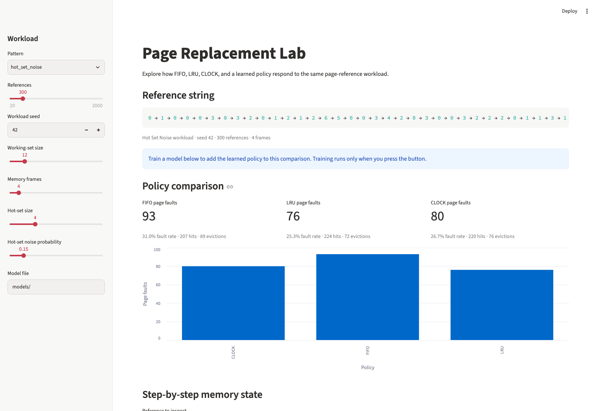
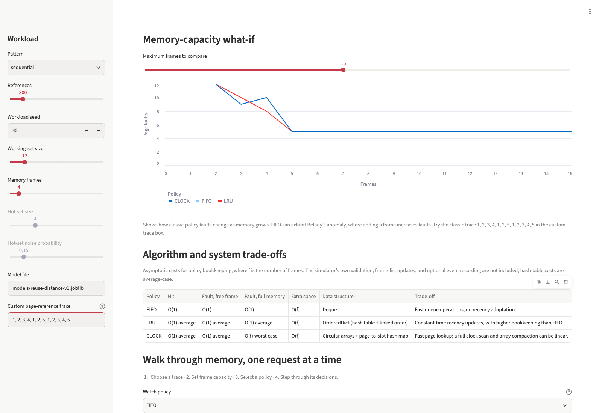

# Page Replacement Simulator

An interactive, trace-driven simulator for exploring how operating-system page replacement policies manage limited memory. Step through FIFO, LRU, and CLOCK, compare page faults, and experiment with a machine-learning policy that predicts which page will be needed furthest in the future.

> This is an educational simulator. It does not modify or benchmark an operating-system memory manager.

## Contents

- [Overview](#overview)
- [Features](#features)
- [Screenshots](#screenshots)
- [Quick start](#quick-start)
- [Deploy to Streamlit Community Cloud](#deploy-to-streamlit-community-cloud)
- [Using the simulator](#using-the-simulator)
  - [Interactive dashboard](#interactive-dashboard)
  - [Command line](#command-line)
  - [Python API](#python-api)
- [Policy behavior and complexity](#policy-behavior-and-complexity)
- [Learned policy](#learned-policy)
- [Run tests](#run-tests)
- [Project layout](#project-layout)

## Overview

A program requests pages in a particular order, called a **reference string**. If a requested page is already in one of the available **memory frames**, it is a hit. Otherwise, a page fault occurs. When all frames are occupied, the replacement policy selects a resident page to evict.

This project makes those decisions visible step by step, reports hits, faults, and evictions, and shows how results change with different policies and memory capacities.

## Features

- **Interactive walkthrough:** inspect each page request, frame state, hit or fault, and eviction.
- **Classic replacement algorithms:** compare FIFO, LRU, and CLOCK.
- **Reproducible workloads:** generate traces from built-in workload patterns using a chosen seed, or provide a custom trace.
- **Capacity analysis:** compare page-fault counts as the number of frames changes. A classic FIFO example demonstrates Belady's anomaly.
- **Learned replacement policy:** train a random forest on synthetic traces and inspect candidate features and predicted next-use distances.
- **Command-line and Python interfaces:** generate traces, run comparisons, train and evaluate the model, or use the simulator from Python.

## Screenshots

Compare page-fault counts across the classic policies:



Step through a looping workload and see the requested page, eviction, current frames, and recent trace:


Inspect the learned policy's candidate features and predicted next-use distances for an eviction:


Explore capacity sensitivity, FIFO's Belady's anomaly, and the algorithmic trade-off table:



## Quick start

Requires Python 3.11 or newer.

Create and activate a virtual environment, install the app and project extras, then launch the dashboard:

```bash
python3 -m venv .venv
source .venv/bin/activate
python -m pip install --upgrade pip
python -m pip install -e ".[dev,ml,plots,app]"
python -m streamlit run src/page_replacement/streamlit_app.py
```

Open [http://localhost:8501](http://localhost:8501) in your browser. Stop the app with **Ctrl+C** in the terminal.

### Windows (PowerShell)

```powershell
py -3 -m venv .venv
.\.venv\Scripts\Activate.ps1
python -m pip install --upgrade pip
python -m pip install -e ".[dev,ml,plots,app]"
python -m streamlit run src/page_replacement/streamlit_app.py
```

## Deploy to Streamlit Community Cloud

The repository includes a root `requirements.txt` with the app and machine-learning dependencies needed by the hosted dashboard.

1. Push the project to GitHub.
2. Sign in at [Streamlit Community Cloud](https://share.streamlit.io/) with GitHub and select **Create app**.
3. Choose this repository, the `main` branch, and `src/page_replacement/streamlit_app.py` as the app's main file.
4. Deploy the app. Community Cloud will install the dependencies from `requirements.txt` and provide a shareable URL.

The app does not need secrets for normal use. After deployment, pushes to the selected branch update the app.

## Using the simulator

### Interactive dashboard

- Choose a workload pattern, seed, and frame capacity in the sidebar.
- Use **Previous**, **Next**, **Play**, or the walkthrough slider to follow memory state changes.
- Enter comma- or space-separated page IDs in **Custom page-reference trace** (up to 500 IDs).
- Train a model in the app to include the learned policy in the comparison.
- Review **Memory-capacity what-if** to compare page faults as frame count changes.
- Review **Algorithm and system trade-offs** for each policy's complexity, data structures, and practical trade-offs.

The actual future next-use distance is displayed only to explain model predictions. It is not available to the policy while it is making an online eviction decision.

### Command line

Generate a reproducible trace and compare policies without opening the dashboard:

```bash
page-replacement generate --workload hot_set_noise --length 1000 --seed 42 \
  --working-set-size 32 --hot-set-size 6 --noise-probability 0.15 \
  --output data/traces/hot-set.csv

page-replacement compare --trace data/traces/hot-set.csv --frames 8 \
  --policies fifo lru clock --csv results/hot-set.csv \
  --plot results/hot-set.png
```

The trace CSV contains `reference_index,page` columns. A same-name JSON file records the format version, workload, seed, length, and generation parameters. The plot option requires Matplotlib; CSV reports do not.

### Python API

```python
from page_replacement.policies import CLOCKPolicy, FIFOPolicy, LRUPolicy
from page_replacement.simulator import simulate
from page_replacement.traces import generate_trace

trace = generate_trace("looping", length=100, seed=7, working_set_size=8)
for name, policy in (
    ("FIFO", FIFOPolicy()),
    ("LRU", LRUPolicy()),
    ("CLOCK", CLOCKPolicy()),
):
    result = simulate(trace.pages, frame_capacity=4, policy=policy)
    print(name, result.hits, result.faults, result.fault_rate)
```

## Policy behavior and complexity

- **FIFO** evicts the page that has been in memory the longest.
- **LRU** evicts the page that has not been used for the longest time.
- **CLOCK** approximates LRU using a reference bit and a circular scan.
- **Learned policy** predicts the next-use distance for each resident page and evicts the page with the largest predicted distance. It is an experimental heuristic, not a guarantee of better results.

The table describes policy bookkeeping, not end-to-end simulator runtime. Let `f` be the number of frames, `u` the number of distinct pages seen, and `e` the number of learned-policy eviction decisions. Hash-table operations are average-case; learned-policy inference also depends on the trained forest.

| Policy | Hit | Fault with full memory | Policy state |
| --- | --- | --- | --- |
| FIFO | `O(1)` | `O(1)` | `O(f)` deque |
| LRU | `O(1)` average | `O(1)` average | `O(f)` ordered hash map |
| CLOCK | `O(1)` average | `O(f)` worst case | `O(f)` circular arrays and page-index map |
| Learned | `O(1)` average | `O(f × model prediction)` | `O(u + f + e × f + model size)` |

CLOCK trades a potentially linear scan for less recency bookkeeping than exact LRU. FIFO and LRU use constant-time policy operations here, while the simulator itself still updates a Python resident list on eviction. Validation and optional event recording also add overhead, so benchmark runtime separately before making performance claims.

The trace `1, 2, 3, 4, 1, 2, 5, 1, 2, 3, 4, 5` produces 9 FIFO faults with 3 frames and 10 with 4 frames, demonstrating **Belady's anomaly**: adding a frame can increase FIFO's fault count.

## Learned policy

Training and evaluation require the `ml` extra, included in the installation command above. Training uses synthetic workload families and seeds. Evaluate on a separate seed to measure results on data not used for training:

```bash
page-replacement train --workloads looping zipf hot_set_noise phase_change \
  --seeds 0 1 2 3 --length 2000 --working-set-size 16 --frames 4 \
  --model models/reuse-distance-v1.joblib

page-replacement evaluate --model models/reuse-distance-v1.joblib \
  --workload hot_set_noise --seed 100 --length 2000 \
  --working-set-size 16 --frames 4 --csv results/held-out.csv \
  --plot results/held-out.png
```

Training creates candidate examples at eviction decisions. Their features describe access history available at that point, including access counts, references since last access, reuse-distance statistics, and time in memory. The training target is the distance to the candidate page's next reference; pages never used again receive a target beyond the end of the trace.

That future-derived distance is a training label, not an online feature. At runtime, the model predicts a distance for each resident candidate and evicts the page with the largest prediction. Results depend on the workload, so compare fault counts across multiple held-out workloads and seeds.

## Run tests

```bash
python -m pytest
```

## Project layout

- `src/page_replacement/` — simulator, policies, trace generators, capacity analysis, CLI, model, and Streamlit app.
- `tests/` — tests for simulation, policies, traces, the model, CLI, and app.
- `docs/screenshots/` — screenshots of the interactive app.
