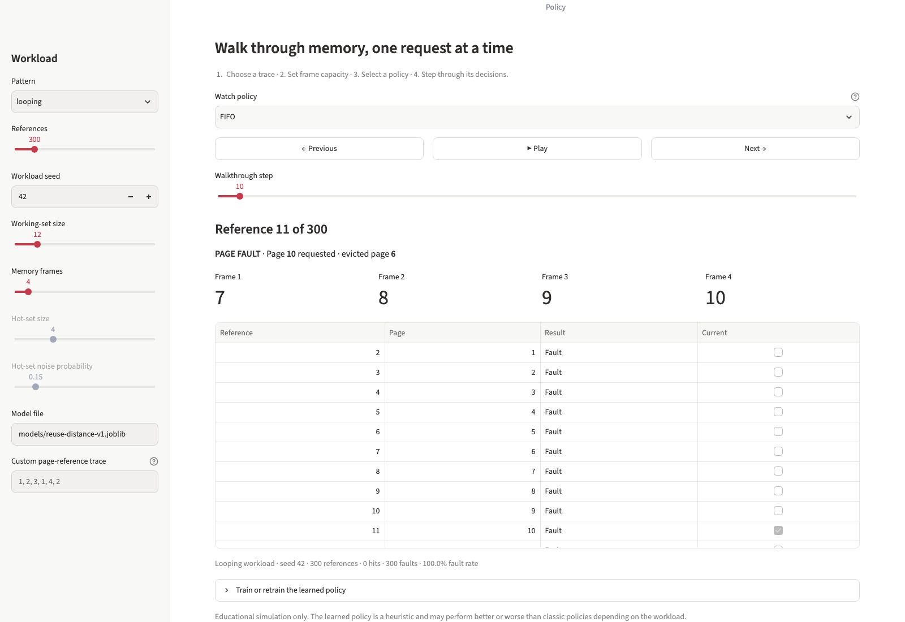
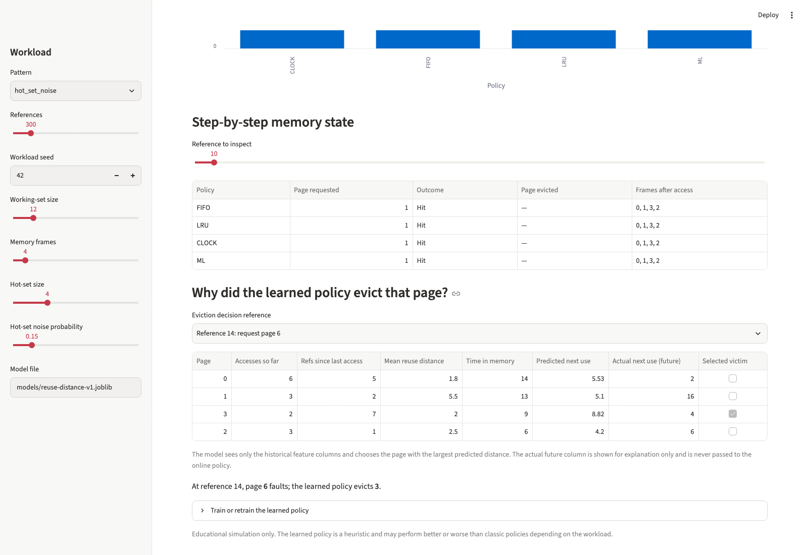

# Page Replacement Simulator

An interactive, trace-driven simulator that shows how operating-system page replacement policies manage a limited number of memory frames. Explore the steps of FIFO, LRU, and CLOCK, compare their page faults, and try a machine-learning policy that estimates when a page may be needed again.

> This is an educational simulator. It does not modify or benchmark an operating-system memory manager.

## What the project demonstrates

A program requests pages in a particular order, called a **reference string**. If the requested page is already in one of the available **memory frames**, it is a hit. Otherwise, a page fault occurs. If all frames are occupied, the replacement policy chooses a resident page to evict.

The simulator makes those decisions visible one request at a time, then summarizes the hits, page faults, and evictions for each policy.

### Replacement policies

- **FIFO** evicts the page that has been in memory the longest.
- **LRU** evicts the page that has not been used for the longest time.
- **CLOCK** approximates LRU using a reference bit and a circular scan.
- **Learned policy** uses a trained random forest to estimate how far in the future each resident page will next be requested, then evicts the page with the largest predicted distance. It is an experimental heuristic, not a guarantee of better results.

## How it works

1. Select a generated workload or enter a custom page-reference trace.
2. Set the number of memory frames and choose a replacement policy.
3. Process each page request in order. The selected policy decides which page to evict when memory is full.
4. Inspect the resulting frame contents and hit/fault outcome, or compare aggregate results across policies.
5. Optionally train the learned policy on synthetic traces and evaluate it on a separate workload.

## Screenshots

Compare page-fault counts across the classic policies:


Step through a looping workload and see the requested page, eviction, current frames, and recent trace:



Inspect the learned policy's candidate features and predicted next-use distances for an eviction:



## Get started

Requires Python 3.11 or newer.

From the project directory, create and activate a virtual environment, then install the project and app dependencies:

```bash
python3 -m venv .venv
source .venv/bin/activate
python -m pip install --upgrade pip
python -m pip install -e ".[dev,ml,plots,app]"
```

Start the Streamlit app:

```bash
python -m streamlit run src/page_replacement/streamlit_app.py
```

Open [http://localhost:8501](http://localhost:8501) in your browser. Stop the app with **Ctrl+C** in the terminal.

### Windows activation

For PowerShell, create and activate the environment, then install the dependencies:

```powershell
py -3 -m venv .venv
.\.venv\Scripts\Activate.ps1
python -m pip install --upgrade pip
python -m pip install -e ".[dev,ml,plots,app]"
```

Start the app with:

```powershell
python -m streamlit run src/page_replacement/streamlit_app.py
```

## Explore the app

- Choose a reproducible workload pattern, seed, and frame capacity in the sidebar.
- Use **Previous**, **Next**, **Play**, or the walkthrough slider to follow memory state changes.
- Enter your own comma- or space-separated page IDs in **Custom page-reference trace** (up to 500 IDs).
- Train a model in the app to add the learned policy to the comparison.
- Review the learned policy's eviction candidates, historical features, and predicted next-use distances.

The actual future next-use distance is displayed only to explain model predictions. It is not available to the policy while it is making an online eviction decision.

## Generate a trace and compare policies

The command-line interface can generate a reproducible trace and compare policies without opening the app:

```bash
page-replacement generate --workload hot_set_noise --length 1000 --seed 42 \
  --working-set-size 32 --hot-set-size 6 --noise-probability 0.15 \
  --output data/traces/hot-set.csv

page-replacement compare --trace data/traces/hot-set.csv --frames 8 \
  --policies fifo lru clock --csv results/hot-set.csv \
  --plot results/hot-set.png
```

The trace CSV contains `reference_index,page` columns. A same-name JSON file records the format version, workload, seed, length, and generation parameters. The plot option requires Matplotlib; CSV reports do not.

## Train and evaluate the learned policy

Training and evaluation require the `ml` extra, included in the installation command above. Training uses synthetic workload families and seeds. Evaluate on a separate seed to measure results on data not used for training:

```bash
page-replacement train --workloads looping zipf hot_set_noise phase_change \
  --seeds 0 1 2 3 --length 2000 --working-set-size 16 --frames 4 \
  --model models/reuse-distance-v1.joblib

page-replacement evaluate --model models/reuse-distance-v1.joblib \
  --workload hot_set_noise --seed 100 --length 2000 \
  --working-set-size 16 --frames 4 --csv results/held-out.csv \
  --plot results/held-out.png
```

Training creates candidate examples at eviction decisions. Their features describe access history available at that point, including access counts, references since last access, reuse-distance statistics, and time in memory. The training target is the distance to the candidate page's next reference; pages never used again receive a target beyond the end of the trace.

That future-derived distance is a training label, not an online feature. At runtime, the model predicts a distance for each resident candidate and evicts the page with the largest prediction. Compare held-out fault counts across multiple workloads and seeds; performance depends on the workload.

## Python API

```python
from page_replacement.policies import CLOCKPolicy, FIFOPolicy, LRUPolicy
from page_replacement.simulator import simulate
from page_replacement.traces import generate_trace

trace = generate_trace("looping", length=100, seed=7, working_set_size=8)
for name, policy in (
    ("FIFO", FIFOPolicy()),
    ("LRU", LRUPolicy()),
    ("CLOCK", CLOCKPolicy()),
):
    result = simulate(trace.pages, frame_capacity=4, policy=policy)
    print(name, result.hits, result.faults, result.fault_rate)
```

## Run the tests

```bash
python -m pytest
```

## Project layout

- `src/page_replacement/` — simulator, policies, trace generators, CLI, model, and Streamlit app.
- `tests/` — tests for simulation, policies, traces, the model, CLI, and app.
- `docs/screenshots/` — screenshots of the interactive app.
